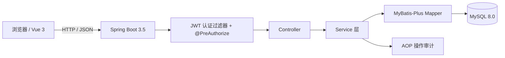

# 医疗后台管理系统（HIS）

一个覆盖「建档 → 挂号 → 接诊 → 处方 → 收费 → 发药 → 检查检验 → 住院 → 公卫 → 报表」全流程的医院后台管理系统。

后端 Spring Boot 3.5 + MyBatis-Plus + Spring Security/JWT，前端 Vue 3 + Element Plus，数据库 MySQL 8。

> 本项目为个人独立作品，用于展示业务建模与后端工程实践。README 中的数字均以仓库内代码为准：**12 个业务模块、42 张业务表（另有 1 张排队号计数器）、161 个 REST 接口、25 个集成测试**。

## 功能模块

| 模块 | 能力 |
|---|---|
| 系统管理 | 用户、角色、菜单、部门、字典、操作审计 |
| 患者管理 | 建档、就诊卡、标签、患者信息 |
| 挂号管理 | 排班、现场挂号、退号、候诊队列 |
| 门诊管理 | 接诊、病历、处方 |
| 收费管理 | 待收费、收费、退费、发票 |
| 药房管理 | 药品、库存、供应商、采购、发药 |
| 住院管理 | 入院、床位、医嘱、护理 |
| 检查检验 | 检查申请、报告 |
| 公共卫生 | 健康档案、疫苗接种、传染病上报、体检、妇幼 |
| 报表中心 | 统计报表、自定义报表 |
| 消息中心 | 站内消息、公告、短信 |
| 审计管理 | 操作日志、登录日志、系统配置、数据备份 |

## 技术栈

| 层次 | 选型 |
|---|---|
| 后端 | Spring Boot 3.5.6、Spring Security、MyBatis-Plus 3.5.12 |
| 认证 | JWT（HS256，120 分钟） |
| 数据库 | MySQL 8.0 |
| 前端 | Vue 3.5、Element Plus 2.11、Pinia、Vue Router、ECharts |
| 构建 | Maven、Vite 7 |

## 架构



后端按业务域拆分模块：`system / patient / registration / clinic / finance / pharmacy / inpatient / exam / health / report / message / audit`。

## 工程实现（可验证的点）

- **挂号并发**：号源 `UPDATE ... WHERE remain_num > 0` 原子扣减；排队号按「科室 + 日期」在计数器表中 `INSERT ... ON DUPLICATE KEY UPDATE` 自增；`(patient_id, schedule_id, active_flag)` 唯一约束兜底重复预约，冲突统一返回 HTTP 409。
- **收费幂等**：事务首行 `SELECT ... FOR UPDATE` 锁定就诊，锁内重查已收费状态；收费/退费/发药/退药均为单向状态条件更新。
- **JWT 改密失效**：token 携带 `ver` 声明，与 `sys_user.token_version` 比对；管理员重置密码时版本 +1，历史 token 立即失效。
- **敏感字段**：身份证 AES-256-GCM 加密（随机 IV），额外存 HMAC-SHA256 检索列支持等值查询；列宽已从 `VARCHAR(20)` 修正为 `VARCHAR(255)`。
- **权限**：RBAC + `@PreAuthorize`，修复了用户分页、部门树、菜单树、公告发布/删除 4 个仅登录即可访问的接口。

## 快速开始

### 1. 初始化数据库

```bash
mysql -uroot -p -e "CREATE DATABASE IF NOT EXISTS medical DEFAULT CHARSET utf8mb4;"
# 按编号顺序执行 sql/ 下的脚本
for f in sql/0*.sql sql/1*.sql; do mysql -uroot -p medical < "$f"; done
```

### 2. 配置本地密钥

```bash
cp backend/src/main/resources/application-local.yml.example \
   backend/src/main/resources/application-local.yml
```

填入 MySQL 密码、JWT 密钥（≥32 字节）和 AES 密钥（Base64 编码的 32 字节）。
`application-local.yml` 已在 `.gitignore` 中，不会提交。

### 3. 启动后端

```bash
cd backend
mvn spring-boot:run
```

接口地址：`http://localhost:8080/api`。

### 4. 启动前端

```bash
cd frontend
npm install
npm run dev
```

访问 `http://localhost:5180`（Vite 已将 `/api` 代理到 8080）。

### 5. 默认账号

种子数据内置 6 个角色，密码统一为 `123456`：

| 用户名 | 角色 |
|---|---|
| `admin` | 超级管理员 |
| `doc01` | 医生 |
| `nurse01` | 护士 |
| `cashier01` | 收费员 |
| `pharmacist01` | 药剂师 |
| `dean01` | 院长 |

## 测试

测试使用独立的 `medical_test` 库，不会污染开发库。首次运行：

```bash
# 1. 初始化测试库（按 sql/01~17 建表并导入种子数据）
DB_PASSWORD=你的MySQL密码 bash scripts/init-test-db.sh

# 2. 运行 25 个集成测试
cd backend
DB_PASSWORD=你的MySQL密码 mvn test
```

覆盖的核心路径：

- 同一患者并发挂号只成功 1 次、排队号无重复、退号后可重挂；
- 并发收费/退费只成功 1 次；
- 处方审核、并发发药、库存扣减与退药回补；
- 身份证 GCM 加解密、按身份证查询、重复建档 409；
- JWT 改密后旧 token 401、无权限接口 403。

覆盖率报告位于 `backend/target/site/jacoco/index.html`。当前整体行覆盖率约 **20%**，核心改动类 **41%–68%**；存量模块（报表、公卫、住院）尚未补测试，README 不虚报覆盖率。

## 设计文档

- [需求文档](docs/requirements.md)
- [接口与字段设计](docs/api-design.md)
- [设计取舍说明](docs/design-decisions.md)

## 已知限制

- 单机部署：登录失败计数是进程内 `ConcurrentHashMap`，多实例部署会失效。
- 普通登出是前端清除 token，服务端不保存会话；改密可通过 token 版本号强制全端下线。
- 挂号、收费的并发控制基于数据库条件更新、行锁与唯一约束，适用于单机部署。
- 测试覆盖集中在新改动的核心链路，整体覆盖率约 20%，未追求 80%。
- 未引入 Redis / 消息队列 / Docker / CI：当前规模下数据库已能保证正确性，引入中间件需有明确收益。

## 说明

本项目为学习与求职展示用途，业务规则参考通用医院信息系统流程，不适用于真实医疗生产环境。
